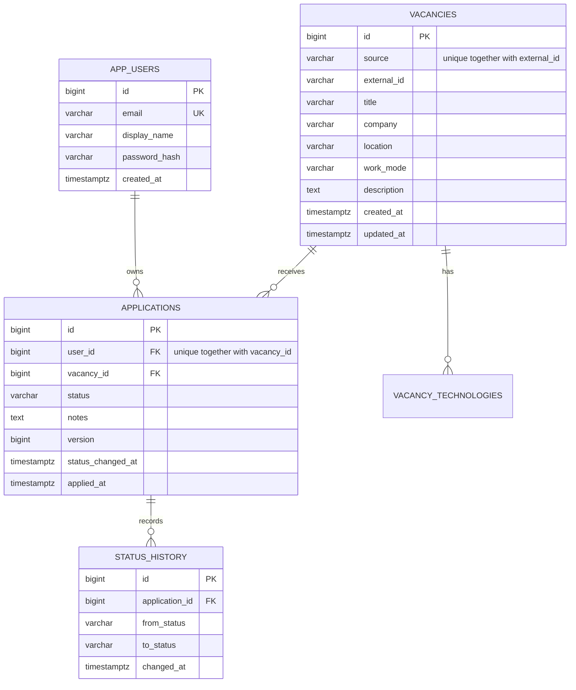

# Architecture and decisions

Application Helper is a modular Spring Boot monolith with a separate React client. PostgreSQL owns durable data; the browser owns temporary form drafts. The deployed client and API share an origin through Nginx. Vite provides the equivalent proxy during development.

## Modules

- `auth`: registration, password hashing, session authentication, current user.
- `vacancy`: source metadata, manual entry, filtering, sorting, pagination.
- `application`: personal tracking, notes, workflow and history, dashboard.
- `importing`: atomic same-source imports.
- `model` / `repository`: JPA entities and persistence.
- `api`: validated request records, response DTOs and problem responses.
- `demo`: explicit opt-in fictional demonstration workspace.

Controllers select the authenticated user. Services implement transaction boundaries and business rules. Response DTOs keep JPA associations and password hashes out of serialization.

## Data model

## Shared catalogue, private applications

Authenticated users share vacancy metadata. An application's owner comes from the server's authenticated principal, never from a client-supplied user ID. Every application read and mutation scopes the query by owner. Unknown and foreign application IDs both return 404. Vacancy list/detail responses join only the current user's application.

A source import can update the shared description. It never touches `applications` or `status_history`. There are no roles or administrative catalogue permissions in this version: any signed-in user can add or import vacancy metadata.

## Idempotency and concurrency

- The database enforces one vacancy per `(source, external_id)`.
- Imports acquire a PostgreSQL transaction advisory lock for the source before the find/update/insert loop. Concurrent imports of the same source serialize, including creation counts. Hash collisions can serialize unrelated sources but do not affect correctness. Different sources can import concurrently.
- The complete batch is one transaction. Invalid URLs, validation failures, or persistence failures cannot leave half an import committed.
- Tracking uses `INSERT ... ON CONFLICT DO NOTHING` and the unique `(user_id, vacancy_id)` constraint. Only the transaction that inserts the application records its initial SAVED history entry.
- Status and note updates lock the owner's application row and check the supplied version. JPA `@Version` increments on an actual change. Stale different updates receive 409 instead of silently overwriting data.
- Repeating the already-current status or the exact same note is a no-op, including after a lost response. No duplicate history is created.
- History and status change in the same transaction. Editing notes does not create status history.

## Workflow

| Current | Allowed next states |
| --- | --- |
| Saved | Applied, Withdrawn |
| Applied | Interview, Rejected, Withdrawn |
| Interview | Offer, Rejected, Withdrawn |
| Offer | Accepted, Rejected, Withdrawn |
| Accepted / Rejected / Withdrawn | Saved (reopen) |

The API includes allowed transitions in each application detail. The client offers those options; the server independently enforces them. Reopening clears the last applied date; the next APPLIED transition sets it again. All previous history remains.

## Authentication

Spring Security manages BCrypt hashes and HttpOnly session cookies. Unsafe requests, registration, login, and logout require the session-backed CSRF token returned by `GET /api/auth/csrf`. The browser requests a fresh masked token before each mutation, which also handles token rotation after authentication.

No credentials or bearer tokens are stored in localStorage. Sessions are kept in the backend process: restarting it signs users out, while database records remain. HTTPS hosting should set `SESSION_COOKIE_SECURE=true`.

## Client behavior

React Router provides page URLs. `useResource` handles reads with AbortController cleanup and request keys so old responses cannot replace a newer search. Mutations show explicit progress and errors; failed note saves preserve the draft. A 401 returns the user to sign-in.

Search filters live in the URL. Pagination and filtering happen in PostgreSQL through JPA specifications. The API caps pages at 100 entries. Import batches are capped at 500 entries; the browser and Nginx cap uploaded JSON at 2 MB.

## Deliberate limits

- Import accepts JSON from a collector; it does not scrape third-party websites or run scheduled jobs.
- Deduplication uses the documented source/external ID pair, not title similarity or cross-source URL matching.
- Email verification, password reset, notifications, and distributed sessions are outside this version.
- Dashboard aggregation loads the current user's application records. This is suitable for a personal job search; a larger deployment can move it to grouped database queries.
- Runtime JSON schema validation in the TypeScript client is not added; server request validation and typed API DTOs define the contract.
- Docker Compose is a reproducible local/demo deployment. Internet hosting, TLS certificates and backups must be configured for the chosen host.
