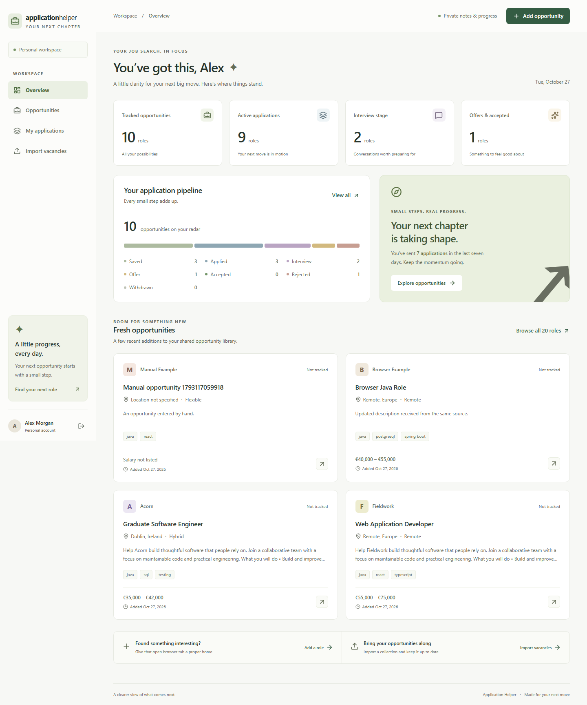
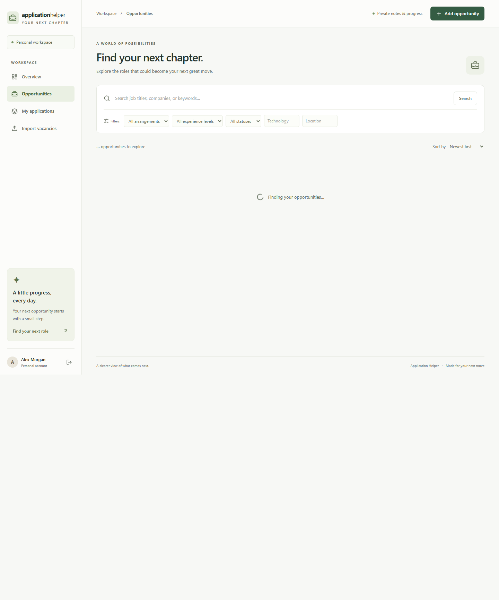
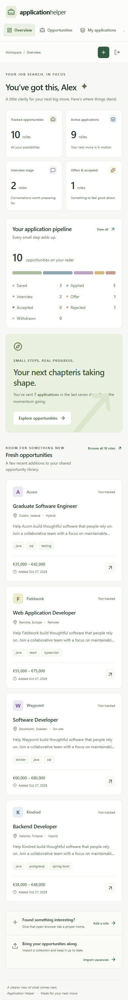

# Application Helper

[](https://github.com/MarSich13/application-helper/actions/workflows/ci.yml)

A job-search CRM for keeping opportunities, application progress, and interview notes in one place.

**Java 25 · Spring Boot 4 · React 19 · TypeScript · PostgreSQL 17**



## What it does

- Shared vacancy library with text search, technology, location, experience, work-arrangement and personal-status filters.
- Sorting and database-backed pagination.
- Vacancy detail pages, original-source links, and manual entry.
- Private saved applications, editable notes, validated status transitions and an activity timeline.
- Dashboard showing active applications, interview-stage roles, offers and activity over the last seven days.
- Registration, sign-in and sign-out through CSRF-protected cookie sessions.
- JSON imports that update metadata without duplicating vacancies or overwriting personal progress.
- Optional LinkedIn MCP collector with a local search profile, durable delivery queue and automatic CRM imports.
- Responsive desktop/mobile interface, keyboard-friendly native dialogs, loading states, empty states and actionable error messages.

## Quick start

Requirements: **Docker Desktop** (Linux containers) or Docker Engine with the Compose plugin. Java and Node do not need to be installed for this path.

```sh
git clone https://github.com/MarSich13/application-helper.git
cd application-helper
docker compose up -d --build --wait
```

Open **[http://localhost:3000](http://localhost:3000)**.

The default `demo` profile creates a fictional workspace once:

| Email | Password |
| --- | --- |
| `demo@example.com` | `DemoPassword123!` |

Use **Fill demo credentials**, then **Sign in**, or create your own account. Vacancy metadata is shared by signed-in users; your notes, applications, and history are private.

The first image build downloads dependencies and can take several minutes. PostgreSQL data lives in the named `postgres_data` volume and survives container restarts.

```sh
docker compose logs -f backend
docker compose down
```

Stopping containers preserves the volume. Removing that volume would delete the database.

### Configuration

Copy `.env.example` to `.env` to change the app port, database host port, password, profile or HTTPS cookie setting. The file is ignored by Git.

For a fresh personal installation without the public demo account, set `SPRING_PROFILES_ACTIVE=default` **before the first start**. Disabling the demo profile later does not delete accounts or existing data. The demo credentials are deliberately public and should not be used for private information.

The app binds to loopback by default. Internet hosting is separate from publishing this repository; configure TLS, `SESSION_COOKIE_SECURE=true` and backups for your host.

## Demonstrate the interesting backend behavior

1. Sign in and open **Import vacancies**.
2. Load the example, or upload [vacancies.initial.json](frontend/public/samples/vacancies.initial.json).
3. Open the imported Java role, save it, move it to **Applied**, and save a private note.
4. Import [vacancies.updated.json](frontend/public/samples/vacancies.updated.json).
5. Open the same vacancy: the description and salary changed; the ID, Applied status, note and history remain.
6. Create a second account: the vacancy is shared, but the first account's application and notes are absent.

The imported vacancy is identified by `(source, externalId)`. A whole batch commits or rolls back together.

## Run from source

For automatic vacancy collection, see [the LinkedIn MCP collector](collector/README.md). It runs alongside the CRM and uses the same import API; its credentials and collected data stay outside Git. Daily scheduling is configured separately in Codex.

Requirements: **JDK 25**, **Node.js 24**, npm, Docker for PostgreSQL and backend integration tests.

Start the database from the repository root:

```sh
docker compose up -d db
```

In one terminal:

```sh
cd backend
./mvnw spring-boot:run -Dspring-boot.run.profiles=demo
```

In another:

```sh
cd frontend
npm ci
npm run dev
```

Open the Vite URL printed in the terminal, normally `http://127.0.0.1:5173`. The development proxy forwards `/api` to `localhost:8080`.

On Windows PowerShell, use `.\mvnw.cmd`, `npm.cmd` and quote the Maven option as `'-Dspring-boot.run.profiles=demo'`. Set `JAVA_HOME` to your JDK 25 directory if Maven cannot find it.

Source-run defaults: PostgreSQL at `localhost:55432/application_helper`, username `application_helper`, password `local-development-only`. If you change the database settings, provide `DATABASE_URL`, `DATABASE_USER` and `DATABASE_PASSWORD` to the backend process. Spring does not automatically read the root Compose `.env` file.

## Verification

Backend tests start a disposable PostgreSQL 17 container and verify migrations, authentication/CSRF, owner isolation, retries, history, optimistic conflicts, concurrent tracking, atomic imports and concurrent imports:

```sh
cd backend
./mvnw -B -ntp verify
```

Frontend:

```sh
cd frontend
npm ci
npm run lint
npm run build
npx playwright install chromium
```

Browser tests against the complete Docker application (PowerShell):

```powershell
$env:E2E_BASE_URL = 'http://127.0.0.1:3000'
npm.cmd run test:e2e
```

POSIX equivalent: `E2E_BASE_URL=http://127.0.0.1:3000 npm run test:e2e`.

With no `E2E_BASE_URL`, Playwright starts Vite; a backend must already run on port 8080. Browser tests create their own accounts and sample vacancies, so use a disposable/demo database. They exercise the real API; deliberate failed-save and server-error responses verify recovery.

CI runs backend/PostgreSQL tests, frontend lint/build, and browser tests against the built Docker Compose stack. Failed browser runs retain traces and screenshots as artifacts.

## Project layout

```text
backend/             Spring Boot API, business rules, migrations, integration tests
frontend/src/        React pages, shared components, typed API client
frontend/e2e/        Playwright browser workflows
frontend/public/     Downloadable import examples and favicon
collector/           Public LinkedIn MCP searches, normalization and reliable API delivery
compose.yaml         PostgreSQL, API, Nginx/client
ARCHITECTURE.md       Schema, transactions, ownership and trade-offs
.github/workflows/   Automated checks
```

Read [ARCHITECTURE.md](ARCHITECTURE.md) for the entity diagram, workflow rules and concurrency decisions. Local learning notes remain outside Git.

## API overview

All endpoints below require authentication except registration, login, configuration, CSRF and the health check. JSON errors use HTTP status codes and a problem `detail`; validation errors also include a `fields` map.

| Method | Endpoint | Purpose |
| --- | --- | --- |
| GET | `/api/auth/csrf` | Token for unsafe requests |
| POST | `/api/auth/register` | Create account |
| POST | `/api/auth/login` | Form-encoded email/password |
| GET | `/api/auth/me` | Current user |
| POST | `/api/auth/logout` | End session |
| GET | `/api/vacancies` | Search, filters, sorting, pagination |
| POST | `/api/vacancies` | Manually add vacancy |
| GET | `/api/vacancies/{id}` | Vacancy and current user's application |
| PUT | `/api/vacancies/{id}/application` | Idempotently start tracking |
| GET | `/api/applications/{id}` | Owner-only application and history |
| PUT | `/api/applications/{id}/status` | Transition with `status`, `version` |
| PUT | `/api/applications/{id}/notes` | Save `notes`, `version` |
| GET | `/api/dashboard` | Personal statistics |
| POST | `/api/imports` | Atomic JSON batch |
| GET | `/actuator/health` | Health check |

Search parameters: `q`, `technology`, `location`, `workMode`, `experience`, `status`, `tracked`, `sort`, `page`, `size`. Pages are zero-based, size is capped at 100, and sorting accepts `newest`, `oldest`, `company`, `title`. Technology matches a complete tag ignoring case. Status can also be `UNTRACKED`.

## More views



<details>
<summary>Mobile workspace</summary>



</details>

## Scope

This version is a complete local job-search CRM with an optional public LinkedIn MCP collector. The Spring Boot application imports JSON through its API; scheduling and external searches run separately in Codex and the collector. Email verification, password reset, personal reminders, external calendar integration and hosted production deployment are future extensions.
